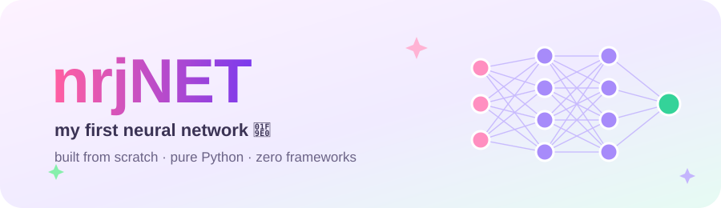
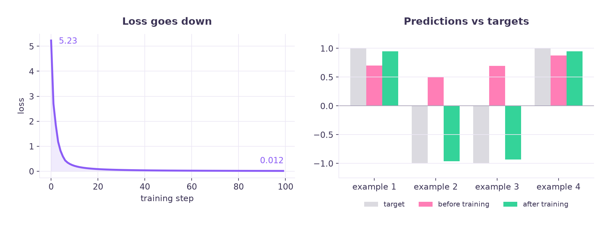

<p align="center">
  
</p>

<p align="center">
  <a href="https://github.com/nrjai/nrjNET/actions/workflows/tests.yml"></a>
  
  
  
  <a href="LICENSE"></a>
</p>

<p align="center">
  <a href="https://colab.research.google.com/github/nrjai/nrjNET/blob/main/notebooks/nrjNET_from_scratch.ipynb">
    
  </a>
</p>

---

## 👋 Hi! This is nrjNET

**nrjNET** is my very first neural network, built **completely from scratch** in plain Python.
No PyTorch, no TensorFlow, no NumPy — just ~250 lines of code where I wrote every single piece myself:

- 🔢 a tiny **autograd engine** that computes gradients automatically
- 🔗 **backpropagation** using the chain rule
- 🧱 **neurons, layers and a multi-layer perceptron**
- 📉 a **gradient descent** training loop

I built it while following Andrej Karpathy's brilliant lecture
[*The spelled-out intro to neural networks and backpropagation*](https://www.youtube.com/watch?v=VMj-3S1tku0).

## ✨ Watch it learn

<p align="center">
  
</p>

The network starts out guessing randomly (🩷 pink). After 100 training steps the loss drops from **5.23 → 0.012**
and every prediction (💚 green) lands right next to its target.

## 🚀 Quick start

```bash
git clone https://github.com/nrjai/nrjNET.git
cd nrjNET
pip install -e .            # installs nrjnet (it has zero dependencies!)

python examples/train.py    # train the network
```

```text
MLP[Layer(3 -> 4), Layer(4 -> 4), Layer(4 -> 1)] | 41 parameters

step   0   loss 5.230518
step  10   loss 0.213094
...
step  99   loss 0.011572
```

Or skip the setup and **[open the notebook in Colab](https://colab.research.google.com/github/nrjai/nrjNET/blob/main/notebooks/nrjNET_from_scratch.ipynb)** 📓

## 🧠 How it works

### 1. `Value` — a number with a memory

Every number remembers **how it was made**. Doing maths with `Value`s quietly builds a graph:

```python
from nrjnet import Value

a = Value(2.0)
b = Value(-3.0)
c = Value(10.0)

d = a * b + c      # d = 4.0, and d remembers: "I came from (a*b) + c"
d.backward()       # walk the graph backwards...

print(a.grad)      # -3.0  -> nudging a up makes d go DOWN 3x as fast
print(b.grad)      #  2.0
print(c.grad)      #  1.0
```

### 2. Backpropagation — the chain rule, automated

Each operation knows its own tiny **local derivative**. `backward()` visits nodes from the output back
to the inputs and multiplies along the way:

```
gradient of an input  =  local derivative  ×  gradient flowing in from the output side
```

```python
def __mul__(self, other):
    out = Value(self.data * other.data, (self, other), '*')
    def _backward():
        self.grad  += other.data * out.grad   # d(a*b)/da = b
        other.grad += self.data  * out.grad   # d(a*b)/db = a
    out._backward = _backward
    return out
```

### 3. Neuron → Layer → MLP

```
inputs (3)     hidden (4)      hidden (4)     output (1)
   x1 ───────►   ○  ─────────►   ○
   x2 ───────►   ○  ─────────►   ○  ─────────►   ○   → prediction
   x3 ───────►   ○  ─────────►   ○
                 ○               ○

each neuron:   out = tanh(w1·x1 + w2·x2 + ... + b)
```

```python
from nrjnet import MLP

model = MLP(3, [4, 4, 1])         # 41 trainable parameters
prediction = model([2.0, 3.0, -1.0])
```

### 4. Training — repeat four steps

```python
for step in range(100):
    loss = sum((model(x) - y) ** 2 for x, y in zip(xs, ys))   # 1. how wrong are we?
    model.zero_grad()                                          # 2. clear old gradients
    loss.backward()                                            # 3. compute new gradients
    for p in model.parameters():
        p.data -= 0.05 * p.grad                                # 4. step downhill
```

## ✅ Is it actually correct?

Yes, and it's checked two independent ways:

| Check | How | Result |
|---|---|---|
| 📏 **Numerical** | nudge each input by a tiny `h`, measure how much the output moves | matches backprop |
| 🔥 **PyTorch** | run the same neuron through `torch.autograd` | matches to every decimal |

```text
        PyTorch    nrjNET
o        0.7071    0.7071
x1      -1.5000   -1.5000
w1       1.0000    1.0000
x2       0.5000    0.5000
w2       0.0000    0.0000
```

Run the tests yourself:

```bash
python -m unittest discover tests -v
```

## 📁 Project structure

```
nrjNET/
├── nrjnet/
│   ├── engine.py          # 🔢 Value: the autograd engine
│   ├── nn.py              # 🧱 Neuron, Layer, MLP
│   └── viz.py             # 🎨 draw the computation graph (optional, needs graphviz)
├── examples/
│   ├── train.py           # 🏋️ train nrjNET
│   └── plot_training.py   # 📉 makes the chart above
├── notebooks/
│   ├── nrjNET_from_scratch.ipynb     # 📓 the full story, step by step
│   └── archive/                      # 🗂️ my original messy notebook
└── tests/
    └── test_engine.py     # ✅ gradient checks + PyTorch comparison
```

## 🐛 Things I learned the hard way

My first notebook had a few bugs that taught me more than the working code did:

| Mistake | What happened | Lesson |
|---|---|---|
| `p.data += lr * p.grad` | The loss went **up** to ~8. Weights exploded to -34 and `tanh` got stuck at 1.0 | The gradient points **uphill**, so always step the **opposite** way (`-=`) |
| Forgot to zero the gradients | Old gradients piled up and training went haywire | `+=` in backprop means you must reset `grad = 0` every step |
| Ran notebook cells out of order | Printed predictions that hadn't been computed yet | Hidden state is sneaky, so always **Run all** from the top |

The original notebook is kept in [`notebooks/archive/`](notebooks/archive/) as a before-and-after 🙂

## 🌱 What's next

- [ ] Add `relu` and compare it with `tanh`
- [ ] Train on a real 2D dataset (the "moons") and plot the decision boundary
- [ ] Add a learning-rate schedule
- [ ] Rebuild nrjNET with tensors (NumPy) to make it fast

## 💜 Credits

- [Andrej Karpathy](https://github.com/karpathy) for the lecture and the original [micrograd](https://github.com/karpathy/micrograd), which this project follows closely
- Built and documented by [Niranjan P](https://github.com/nrjai) as a learning project

<p align="center"><sub>made with 🧠 + ☕ — one gradient at a time</sub></p>
